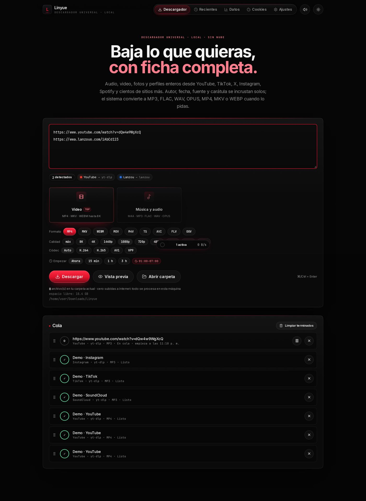
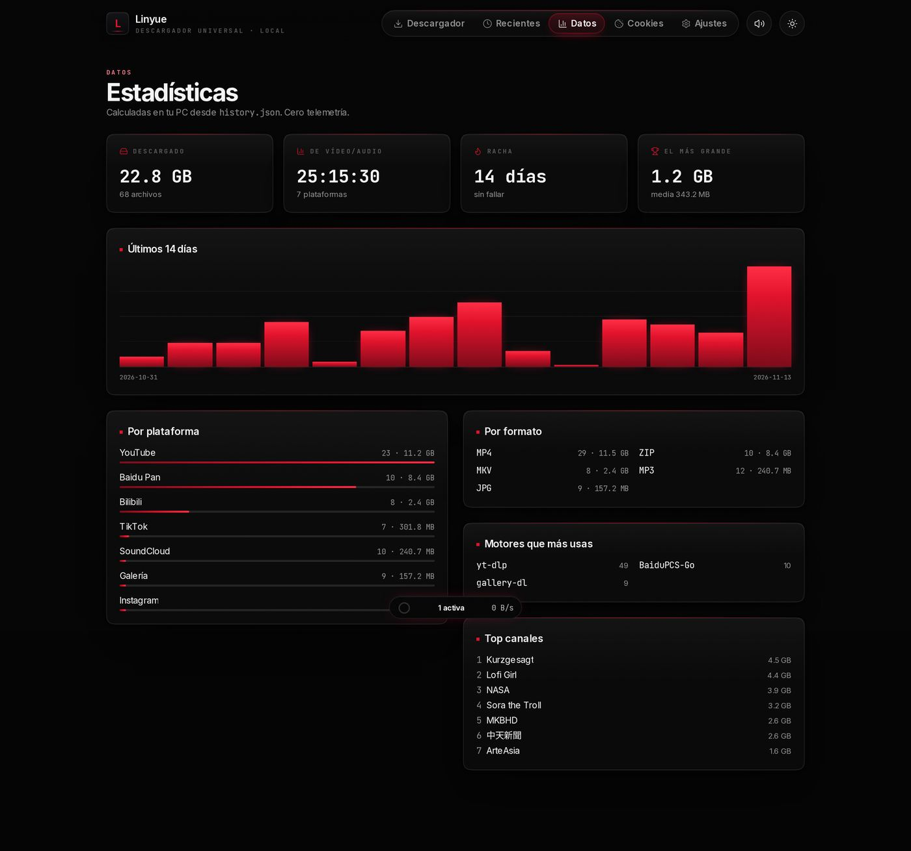
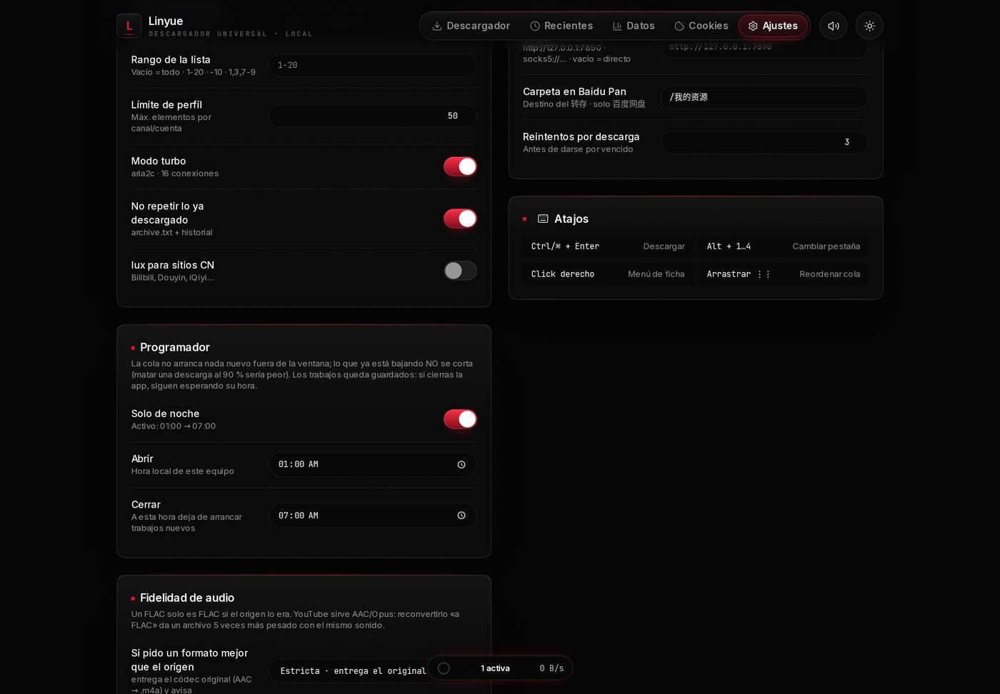
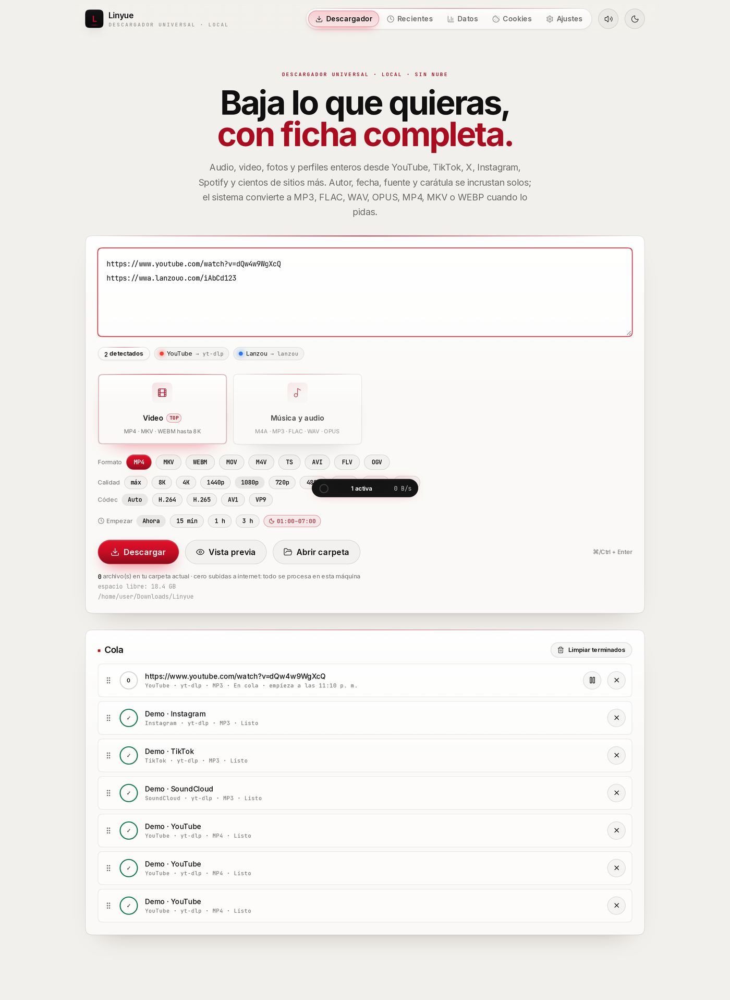

<div align="center">

# Linyue · 林玥

**Descargador universal local.** Audio, vídeo, fotos y perfiles enteros, con ficha completa.
Todo se procesa en tu PC: **cero nube, cero telemetría, cero subidas**.

<sub>17 motores · 234 tests · Next.js 16 · Windows primero, Linux también</sub>

</div>



---

## Qué hace

| | |
|---|---|
| **Audio** | M4A · MP3 · FLAC · WAV · OPUS · AAC · Vorbis · ALAC · AIFF · AC3 · EAC3 · DTS · MP2 |
| **Vídeo** | MP4 · MKV · WEBM · MOV · M4V · TS · AVI · FLV · OGV — hasta 8K, con códec elegible (H.264 · H.265 · AV1 · VP9 · VP8) |
| **Imagen** | Original · WEBP · JPG · PNG · AVIF · BMP · TIFF · GIF |
| **Perfiles** | Canal, cuenta o lista completa, con rango (`1-20`, `-10`, `1,3,7-9`) |
| **Chino** | 百度网盘 (con tu cuenta) · 百度贴吧 · **蓝奏云** · **阿里云盘** |
| **Cola** | Persistente: si cierras la app, se reanuda donde iba |
| **Programador** | «Solo de noche» 01:00–07:00 y retraso por trabajo (15 min / 1 h / 3 h) |
| **Datos** | GB, tiempo, plataformas, racha, récord y reparto por canal — todo desde `history.json` |

## Cómo arrancarlo (Windows)

1. **Descarga el ZIP** (botón verde *Code* → *Download ZIP*) y descomprímelo.
2. Entra en `version-final` y haz doble clic en **`iniciar_linyue.bat`**.

El `.bat` instala las dependencias la primera vez, compila y abre
`http://127.0.0.1:4173` — **solo en local**, no queda expuesto a tu red.

Requisitos: **Node.js 20 o superior** y los `.exe` de `vendor/` (ya vienen en el repo).

<details>
<summary>Arrancarlo a mano (o en Linux)</summary>

```bash
cd version-final
npm install
npm run build
npx next start -H 127.0.0.1 -p 4173
```

Para probar sin motores reales (todo simulado, cero binarios):

```bash
LINYUE_MOCK_ENGINES=1 npm run dev
```
</details>

## Capturas

| Datos | Ajustes |
|---|---|
|  |  |

Modo claro **Hueso**:



## Lo que **no** hace (y por qué)

- **No** descarga Baidu Wenku: el documento se pinta en canvas con texto ofuscado y la descarga es de pago. Alternativa honesta: `Ctrl+P` → *Guardar como PDF*.
- **No** salta DRM (Netflix, Spotify premium, Audible). No es una limitación del programa, es que no se puede.
- **No** guarda ni pide credenciales de cuentas ajenas. Las de 百度网盘 y 阿里云盘 son **tuyas** y las gestiona el CLI (`aliyunpan login`), nunca la app.
- **No** promete paralelismo infinito: hay techo configurable y enfriamiento por host para no comerse un 429.
- **蓝奏云** cambia de dominio y de HTML cada pocos meses: el extractor es propio y, si el formato cambia, lo dice con un error claro en vez de fallar en silencio.

## Documentación

| Archivo | Contenido |
|---|---|
| [`version-final/MOTORES.md`](version-final/MOTORES.md) | Los 17 motores, códecs, contenedores, cola, proxy, disco, programador, Lanzou y Aliyun |
| [`version-final/SEGURIDAD.md`](version-final/SEGURIDAD.md) | Auditoría: CSRF, SSRF, `outputDir`, inundación de sondas |
| [`version-final/SITIOS-CON-CUENTA.md`](version-final/SITIOS-CON-CUENTA.md) | Qué se puede y qué no en la familia Baidu |
| [`version-final/MEJORAS.md`](version-final/MEJORAS.md) | Informe técnico: bugs encontrados y corregidos, fase por fase |
| [`version-final/DISENO.md`](version-final/DISENO.md) | Sistema visual «Carbón y Carmesí» y contraste medido |
| [`version-final/README.md`](version-final/README.md) | Arquitectura, scripts, estructura de descargas y problemas típicos |

## Estado

```
tsc --noEmit   0 errores
vitest run     234/234
eslint .       0 errores, 0 avisos
next build     compila
```

Comprobado además con un recorrido automatizado en navegador real: las cinco
pantallas, una descarga completa y dos cambios de tema, **sin un solo error** de
consola, `pageerror` ni respuesta 4xx/5xx.

---

<sub>Hecho para uso personal. Respeta los términos de los sitios que descargues y
los derechos de quien publicó el contenido.</sub>
